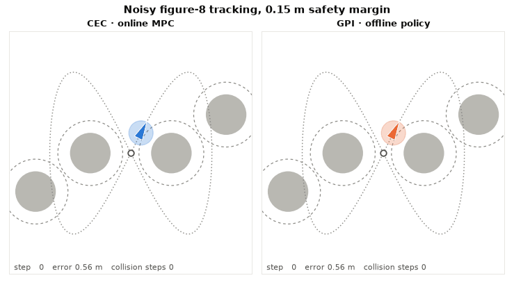
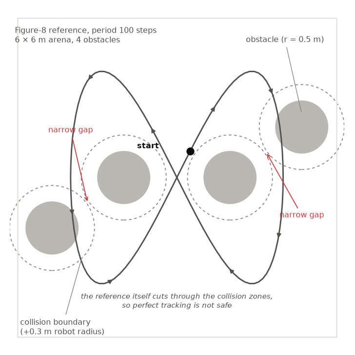
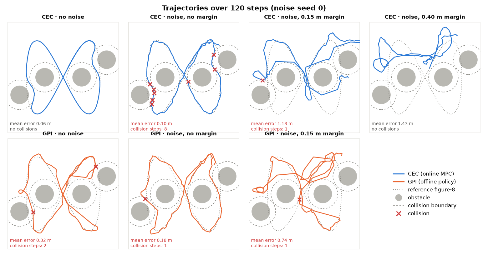
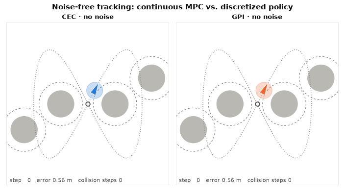
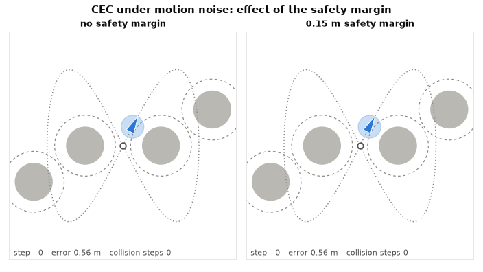
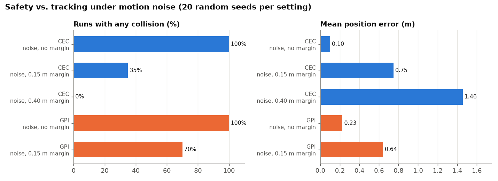
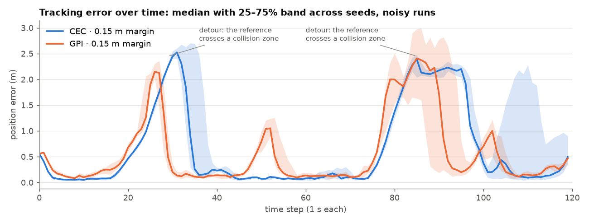
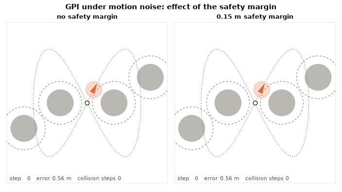
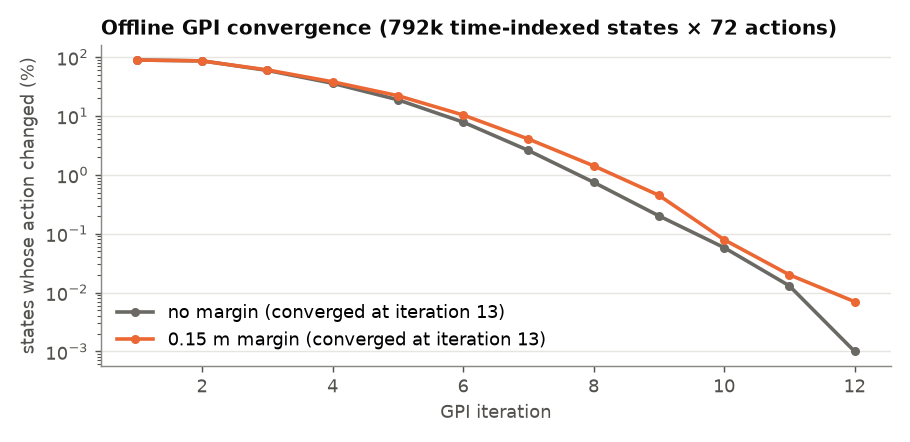

# Safe Trajectory Tracking under Uncertainty: MPC vs. Dynamic Programming

A differential-drive robot has to follow a figure-8 path through a field of obstacles while random motion noise pushes it off course. This project builds two optimal controllers for the task and compares them:

- **CEC**: receding-horizon *certainty-equivalent control*, a nonlinear MPC that re-solves an optimization problem at every step.
- **GPI**: *generalized policy iteration*, which discretizes the problem into a Markov decision process, solves it offline, and drives the robot with a table lookup.

  

> Built for UCSD ECE 276B (Planning & Learning in Robotics), Spring 2026. The source code is intentionally not published. This repository presents the problem, the approach and the results.

---

## The problem

- **Robot:** unicycle model with state $(x, y, \theta)$ and controls $v \in [0.1, 1]$ m/s, $\omega \in [-1, 1]$ rad/s, at 1 s steps.
- **Noise:** each step adds Gaussian noise $\sigma = (0.04,\ 0.04,\ 0.004)$.
- **Arena:** a 6 × 6 m box with four circular obstacles (radius 0.5 m). The robot itself has a 0.3 m radius.
- **Goal:** stay close to a moving reference point on a figure-8 (100-step period) without hitting anything.

**Why it's hard:** the reference path itself runs **through** the collision zones (dashed circles), and two pairs of obstacles leave only narrow gaps. Perfect tracking would crash. A controller has to decide when to leave the path, and how much safety buffer to keep when it can't predict exactly where the noise will push it.

The task is posed as a discounted infinite-horizon stochastic optimal control problem on the **tracking error** $e_t = (\tilde p_t, \tilde\theta_t)$:

$$
\min_\pi \ \mathbb{E}\Big[\sum_{t} \gamma^t \big(\tilde p_t^\top Q \tilde p_t + q(1-\cos\tilde\theta_t)^2 + u_t^\top R u_t\big)\Big]
\quad \text{s.t. robot stays in free space}
$$

 

## Two approaches

| | **CEC: online MPC** | **GPI: offline dynamic programming** |
|---|---|---|
| **Idea** | Replace the noise with its mean (zero) and solve a deterministic nonlinear program over a 59-step horizon at every step. Apply only the first control. | Discretize error-state and controls into a time-periodic MDP with a Gaussian transition model, then solve it with policy evaluation and improvement. |
| **Safety** | Hard constraints: keep the predicted robot outside each obstacle, inflated by a tunable **safety margin**. | States inside an inflated obstacle get a 10¹⁰ cost, so the policy learns to avoid them. |
| **Extras** | Warm start from the shifted previous solution. Solved with IPOPT via CasADi. | 7,920 error states × 100 time indices × 72 actions. Each transition spreads over 8 neighbouring grid cells. Fully vectorized. |
| **Online cost** | One NLP solve per step | One table lookup per step |

## Results

Each noisy setting was run with **20 random noise seeds** (120 steps each). A *collision step* is a time step where the robot's body overlaps an obstacle.

### At a glance

| Setting | Runs with a collision | Collision steps / run | Mean position error | Mean heading error | Online time / step |
|---|:-:|:-:|:-:|:-:|:-:|
| CEC, no noise | 0 / 1 | 0 | **0.06 m** | 5° | 318 ms |
| CEC, noise, no margin | 20 / 20 | 4.95 | 0.10 m | 9° | 241 ms |
| CEC, noise, 0.15 m margin | 7 / 20 | 0.85 | 0.75 m | 40° | 350 ms |
| CEC, noise, 0.40 m margin | **0 / 20** | **0** | 1.46 m | 51° | 647 ms |
| GPI, no noise | 1 / 1 | 2 | 0.32 m | 29° | **0.03 ms** |
| GPI, noise, no margin | 20 / 20 | 1.75 | 0.23 m | 23° | 0.04 ms |
| GPI, noise, 0.15 m margin | 14 / 20 | 1.10 | 0.64 m | 40° | 0.03 ms |

GPI also needs a one-time offline solve of about **2–3 minutes** (126–182 s). The policy converges in 13 iterations.

### 1. Without noise, CEC tracks almost perfectly

When the model matches reality, CEC follows the figure-8 to within **6 cm** on average. It bends just enough to graze past each obstacle boundary. GPI follows the same route, but its coarse grid shows: steering is jerky, average error is about 5× higher, and it clips a boundary for two steps.

### 2. Noise breaks the "graze the obstacle" strategy

The plan that was safe without noise now fails in **every one of 20 runs**. CEC plans as if there were no noise, so it keeps aiming for paths that skim the obstacle boundary, and the noise pushes it over the line. The collisions are shallow scrapes (about 5 cm deep), but a real robot would still be hitting things.

Inflating the obstacles by a **safety margin** fixes this. At 0.15 m the planner stops squeezing through the narrow gaps and cuts through the middle of the arena, which brings the collision rate down from 100% to 35%. At 0.40 m the narrow gaps close entirely and **no run collides**.

### 3. The safety–accuracy trade-off

Safety costs accuracy. Each extra margin lowers collisions but pulls the robot further from the reference, because the detours get wider. Most of the error is concentrated in two detours, where the reference passes through a collision zone:

### 4. GPI: same lesson, with discretization on top

GPI accounts for noise directly in its transition model, and the margin moves its route away from the narrow gaps just like CEC. It is not as safe, though: with the same 0.15 m margin, 70% of GPI runs still scrape an obstacle, against 35% for CEC. The policy only sees the robot's error snapped to the nearest grid cell, so it cannot react to small deviations near an obstacle edge.

## Takeaways

- **The safety margin is the most important tuning knob.** Too small and noise causes collisions. Too large and the robot strays far from the reference. Neither method handles this on its own.
- **CEC gives smoother, more accurate and safer tracking**, at the price of solving a nonlinear program every step (~0.25–0.65 s here).
- **GPI is ~10,000× cheaper online** (a lookup in microseconds) after a few minutes of offline work. That suits robots with little onboard compute in a known environment, but its accuracy is limited by grid resolution.
- **Bigger is not always better.** Longer CEC horizons and more GPI evaluation sweeps both hurt performance past a point. Long horizons made the optimizer erratic, and extra sweeps spread discretization error through the value function.

## Tech

Python · NumPy · CasADi + IPOPT (nonlinear programming) · Matplotlib

Timings were measured on a consumer Windows laptop (Python 3.13) and are indicative only.

## License

[MIT](LICENSE) © 2026 Stephen Huang
